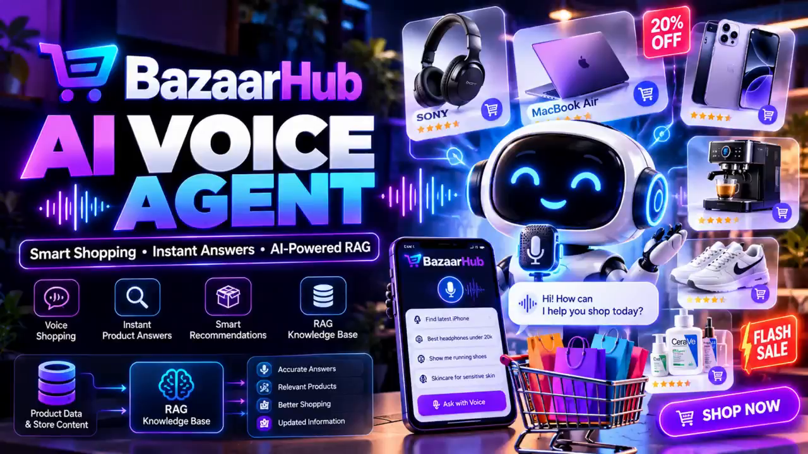
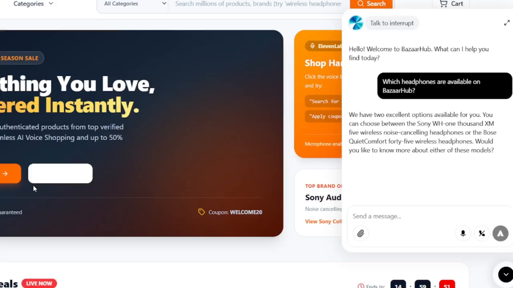
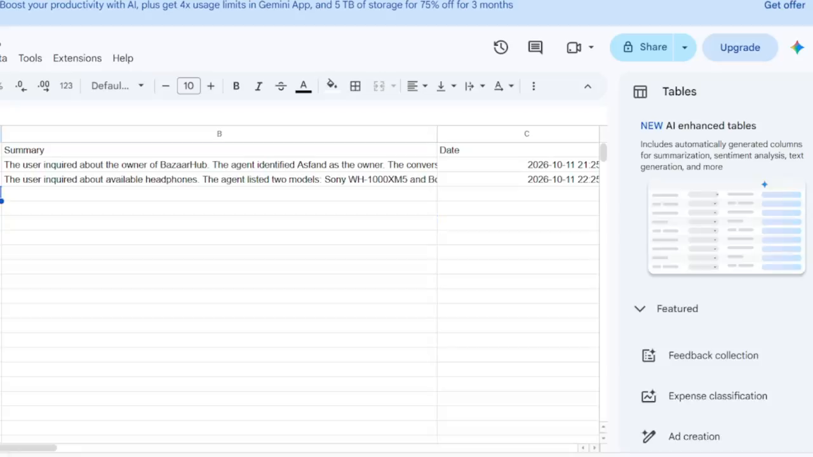

# BazaarHub — AI Voice Shopping Assistant

> An ElevenLabs voice agent embedded in an e-commerce store that answers product and store-policy questions grounded in a RAG knowledge base — and logs a summary of every conversation to Google Sheets.

🎬 **Demo:** [Watch on LinkedIn](https://lnkd.in/p/da7wR5GJ) · See [`demo/VIDEO-LINK.md`](demo/VIDEO-LINK.md) for the video breakdown with timestamps.

---

## Overview

BazaarHub is a demo e-commerce storefront ("Everything You Love, Delivered Instantly") with an AI voice shopping assistant built in. Instead of browsing categories or typing into a search box, a shopper clicks the voice button on the store page and simply *asks*:

- *"Which headphones are available on BazaarHub?"*
- *"What colors are available for the Apple MacBook Air fifteen-inch M3?"*
- *"Can you tell me the return policy of BazaarHub?"*

The assistant answers out loud, in natural conversational speech, using product and store information held in a Retrieval-Augmented Generation (RAG) knowledge base. When a conversation ends, a short written summary of what was discussed is automatically appended — with a timestamp — to a Google Sheets conversation log.

> **Documentation basis:** This repository documents the project **from its demonstration video only**. No source code, workflow export, or live deployment is included. Anything the video does not show is explicitly marked **"Not confirmed from video."** See [`PROJECT-LIMITATIONS.md`](PROJECT-LIMITATIONS.md).

## The Business Problem

Online stores lose sales at the exact moment a shopper has a question:

- Product details (models, colours, variants) are spread across many product pages.
- Store policies (returns, buyer protection) are buried in footer links and help pages.
- Shoppers on mobile — or with hands busy — won't type long searches or read long pages.
- Store owners get no visibility into *what shoppers are actually asking about*, so catalogue and content gaps stay invisible.

Support teams end up answering the same product and policy questions repeatedly, while unanswered questions turn into abandoned sessions.

## The Solution

A voice-first assistant that lives directly on the store page:

1. **Voice (or typed) questions** — the shopper speaks to the ElevenLabs agent embedded in the storefront, or types in the same widget.
2. **Grounded answers** — answers come from a RAG knowledge base built from product data and store content, so the agent talks about *this store's* products and *this store's* policies rather than generic world knowledge.
3. **Conversational follow-ups** — after each answer the agent offers the natural next step ("Would you like to know more about either of these models?", "Would you like to know about the available memory options for this laptop?").
4. **Automatic conversation logging** — every conversation is summarised and appended to Google Sheets with a timestamp, giving the store a searchable record of shopper intent.

## Key Features

### ✅ Demonstrated in the video

| Feature | Evidence in the demo |
|---|---|
| Voice conversation on the store page | ElevenLabs widget with "Listening" / "Talk to interrupt" states, microphone controls, and a typed "Send a message…" fallback |
| Conversational greeting | "Hello! Welcome to BazaarHub. What can I help you find today?" |
| Product discovery Q&A | Asked which headphones are available → agent names the **Sony WH-1000XM5** and **Bose QuietComfort 45** wireless models and offers more detail on either |
| Product attribute Q&A | Asked for MacBook Air 15-inch M3 colours → **midnight, starlight, space gray, silver**, then offers the memory options |
| Store-policy Q&A | Asked for the return policy → "a thirty-day hassle-free return policy with full buyer protection for eligible products," then offers more policy/product help |
| Idle re-engagement | After a pause, the agent checks in: "Are you still there? I am happy to help you with any other questions you have about the MacBook Air or our other products." |
| Automatic conversation summaries | Google Sheets log (columns **Summary \| Date**) shows one summary row per conversation, e.g. a headphones enquiry summarised and timestamped `2026-10-11 22:25` |
| Store-knowledge answers beyond products | A logged summary shows the agent answered who owns BazaarHub ("The agent identified Asfand as the owner") — store content, not just catalogue data |

### 📣 Stated (caption / title card) — positioning, not independently demonstrated

| Claim | Source |
|---|---|
| "Smart Recommendations" | Title-card feature tile |
| "Instant Responses" / "Instant Product Answers" | Caption and title card |
| Price and availability questions | Caption lists prices/features/availability as question types — **no price or stock figure is actually quoted in the video** |
| RAG pipeline: "Product Data & Store Content → RAG Knowledge Base → Accurate Answers / Relevant Products / Better Shopping / Updated Information" | Title-card pipeline graphic |
| Suggestion chips on the voice card ("Search for…", "Apply coup[on]…") | Visible on the store page; the coupon flow is **not** exercised in the demo |

## Technologies

| Layer | Technology | Status |
|---|---|---|
| Voice agent | **ElevenLabs** (conversational voice agent, embedded widget) | ✅ Verified from video (branding and widget UI on the store page) |
| Knowledge grounding | **RAG knowledge base** over product data & store content | ✅ Stated in caption + title card; behaviour consistent with the answers shown |
| Storefront | BazaarHub demo e-commerce website (categories, search, cart, Flash Deals, Season Sale, coupon WELCOME20) | ✅ Verified from video |
| Conversation log | **Google Sheets** (Summary \| Date) | ✅ Verified from video |
| LLM / model behind the agent | — | ⚠️ **Not confirmed from video** |
| Vector store, embedding model, chunking strategy | — | ⚠️ **Not confirmed from video** |
| Orchestration / logging component (what writes summaries to Sheets) | — | ⚠️ **Not confirmed from video** — no automation canvas (e.g. n8n) is shown, and none is claimed |

## Architecture (as evidenced)

```
Shopper ──voice/typed question──▶ ElevenLabs voice widget (on store page)
                                        │
                                        ▼
                              BazaarHub AI agent
                              (greeting, dialogue,
                               follow-up offers,
                               idle re-engagement)
                                        │
                          grounded in   ▼
                     ┌────────────────────────────────┐
                     │  RAG Knowledge Base            │
                     │  Product Data & Store Content  │
                     │  (internals not shown)         │
                     └────────────────────────────────┘
                                        │
                     conversation ends  ▼
                     Summary + timestamp appended
                     to Google Sheets log
```

Full detail: [`PROJECT-ARCHITECTURE.md`](PROJECT-ARCHITECTURE.md) · Step-by-step lifecycle: [`WORKFLOW-EXPLANATION.md`](WORKFLOW-EXPLANATION.md)

## How It Works (step by step)

1. The shopper opens the BazaarHub storefront and starts the voice assistant from the on-page card ("Shop Hands-free" — click the voice button; suggestion chips offer starter prompts).
2. The agent greets the shopper and listens (widget shows "Listening"; the shopper can interrupt mid-answer — "Talk to interrupt" — or type instead).
3. The shopper asks a product or policy question.
4. The agent retrieves the relevant product/store content from the RAG knowledge base and answers in spoken, voice-friendly phrasing (e.g. "Sony WH-one thousand XM five").
5. The agent offers a relevant follow-up (more detail, another attribute such as memory options, or another policy).
6. If the shopper goes quiet, the agent sends a gentle re-engagement nudge.
7. When the conversation ends, a one-paragraph summary and the date/time are appended to the Google Sheets conversation log.

## Screenshots

| Asset | What it shows |
|---|---|
|  | Title card — "BazaarHub AI VOICE AGENT · Smart Shopping · Instant Answers · AI-Powered RAG" with the RAG pipeline graphic (video ~0:00) |
|  | System front-end overview — the BazaarHub storefront with the ElevenLabs widget open, answering the headphones question (video ~0:03). **No workflow/automation canvas exists in the video**, so this front-end view is the closest visual overview of the running system |
|  | Result view — the Google Sheets conversation log (Summary \| Date) with per-conversation summaries and timestamps (video ~0:07) |

## Use Cases

- **Product discovery** — "Which headphones do you have?" answered without navigating category pages.
- **Variant/attribute questions** — colours, sizes, memory options answered conversationally.
- **Policy self-service** — returns and buyer-protection questions answered instantly, deflecting repetitive support tickets.
- **Hands-free / accessibility-friendly shopping** — full Q&A by voice on mobile.
- **Voice-of-customer insight** — the Sheets summary log shows what shoppers ask about (products, policies, the store itself), surfacing catalogue and content gaps.

## Setup (summary)

A rebuild needs: an ElevenLabs conversational agent, a knowledge base built from the store's product data and store content, the agent embedded on the storefront, and a Google Sheets log that receives a summary + timestamp per conversation. Credential *types* only are listed — no secrets are documented. Full guide with verified vs. reconstructed steps clearly separated: [`SETUP-GUIDE.md`](SETUP-GUIDE.md).

## Limitations

- Documentation is reconstructed from a ~53-second demo video; no code, agent configuration, or knowledge-base contents are available.
- No automation/workflow canvas is shown — the component that summarises conversations and writes to Google Sheets is **not confirmed from video**.
- RAG internals (vector store, embeddings, chunking, update process) are **not confirmed from video**.
- No price or stock/availability answer is demonstrated, although the caption lists those as question types.
- Title-card claims ("Smart Recommendations", "Instant Answers") are the project's own positioning.

Full disclosure: [`PROJECT-LIMITATIONS.md`](PROJECT-LIMITATIONS.md)

## Future Improvements

*(Suggestions only — none of these are shown in the video.)*

- Publish the knowledge-base update process so catalogue changes re-index automatically.
- Add price/stock answers with a live inventory connection, demonstrated end-to-end.
- Let the agent add recommended products to the cart by voice.
- Add analytics on the Sheets log (top questions, unanswered-question detection).
- Support additional languages for voice shopping.

## Author

**Fahad Ahmed Shanawar**

- GitHub: https://github.com/AiwithFahad
- LinkedIn: https://www.linkedin.com/in/fahad-ahmed-shanawar-107a5535a/
- Demo video: [Watch on LinkedIn](https://lnkd.in/p/da7wR5GJ)
